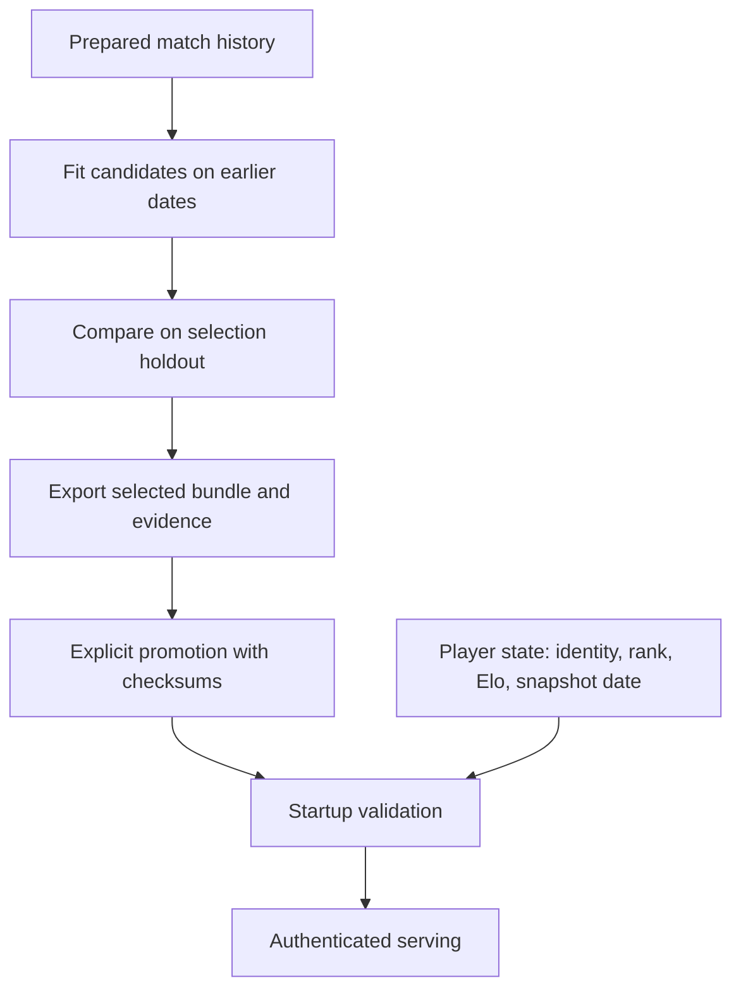

# Tutorial

Read these chapters in order. The emphasis is model-validity-first: establish
the prepared-data boundary, test causal and temporal assumptions, select the
best probability model, and only then discuss artifacts and serving.

Every chapter answers the same five questions: **what problem exists, the
smallest command to inspect it, what that command proves, the design choice,
and the intentional boundary.** Terms are defined where they first matter;
guides hold the fuller implementation detail.

## Read In Order

1. [01 The Prepared-Data Boundary](./01-notebook-to-data-contract.md)
2. [02 Model Validity, Selection, And The Feature Contract](./02-feature-contract-training-and-export.md)
3. [03 Artifact Reproducibility And Trust](./03-reproducibility-versioning-and-dependencies.md)
4. [04 Serving Validated Predictions](./04-serving-async-and-monitoring.md)
5. [05 Authentication And Caller Identity](./05-authentication-authorization-and-access-boundaries.md)
6. [06 Implemented Observability](./06-observability-logging-metrics-and-traces.md)
7. [07 Validation And Release Boundaries](./07-validation-ci-deployment-and-boundaries.md)

The optional
[starter notebook](../assets/notebooks/01-starter-feature-and-training-flow.ipynb)
uses only the 100-row transformation sample. `just notebook-check` executes it
without changing the committed file. The notebook cannot reproduce the
44,617-row production dataset and never exports or promotes a model.

## Lifecycle

The selection holdout chooses the model; no independent final test is
implemented. Export does not promote a bundle, and promotion does not refit it.
Player state is a separate validated input to serving.

## Implementation Map

- `src/acebet/dataprep/dataprep.py`: prepared-data validation and player state
- `src/acebet/features.py`: shared 17-column offline/online feature contract
- `src/acebet/train/train.py`: grouped selection holdout, three candidates, metrics
- `src/acebet/model_artifacts.py`: selection, schema-v2 integrity, promotion
- `src/acebet/app/routers/`: operational, authentication, prediction routes
- `src/acebet/app/observability.py`: request IDs, bounded metrics, tracing
- `tests/`: data, selection, artifact, API, packaging, and tutorial contracts

Complete [Getting Started](../getting-started.md) before running the commands.
Use [Training and Inference](../user-guide/training-and-inference.md) or
[Model Artifacts and Promotion](../user-guide/model-artifacts-and-promotion.md)
for implementation detail. [Tutorial Boundaries](../tutorial-shortcuts-vs-production.md)
is the single implemented-versus-missing matrix.
